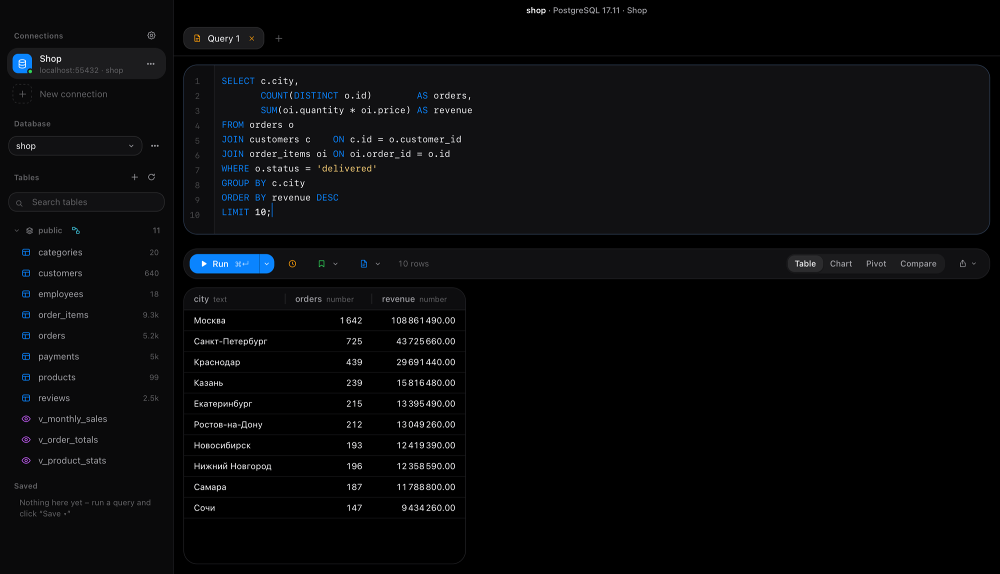
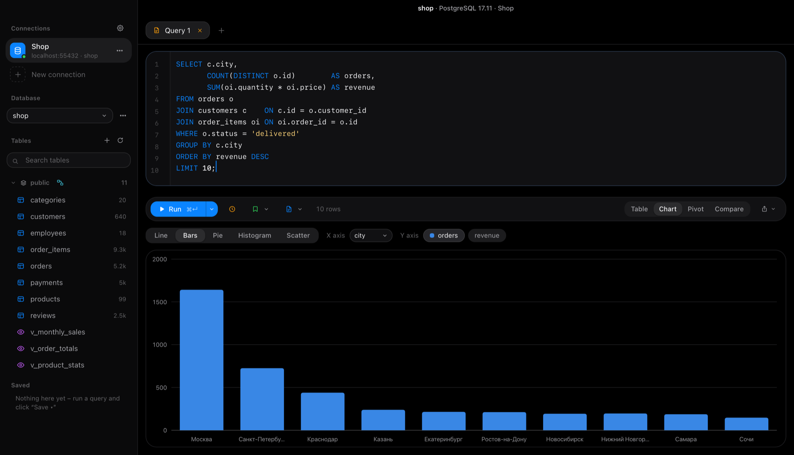
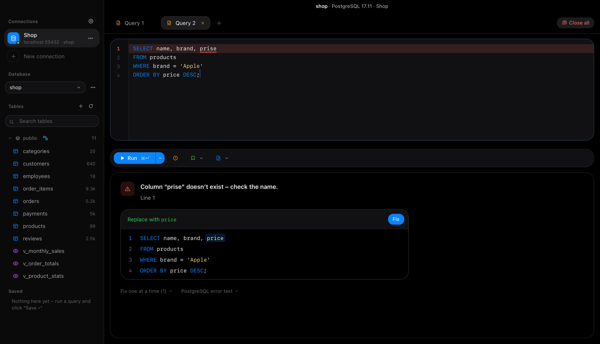
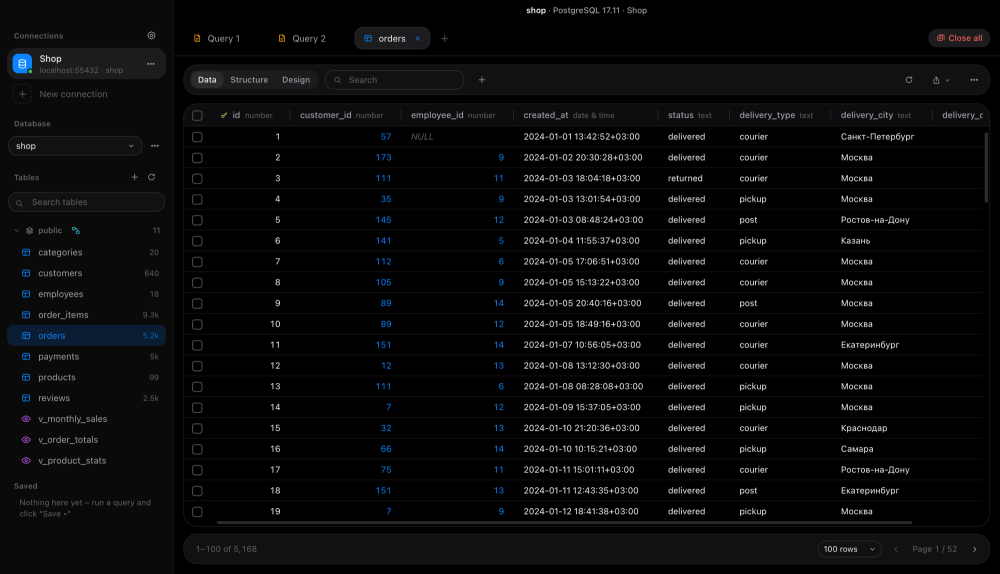
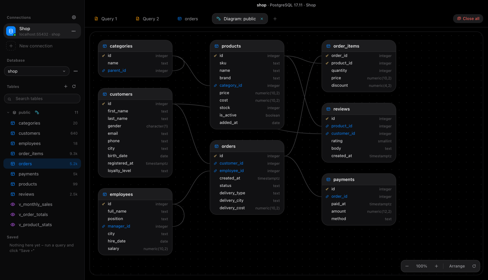
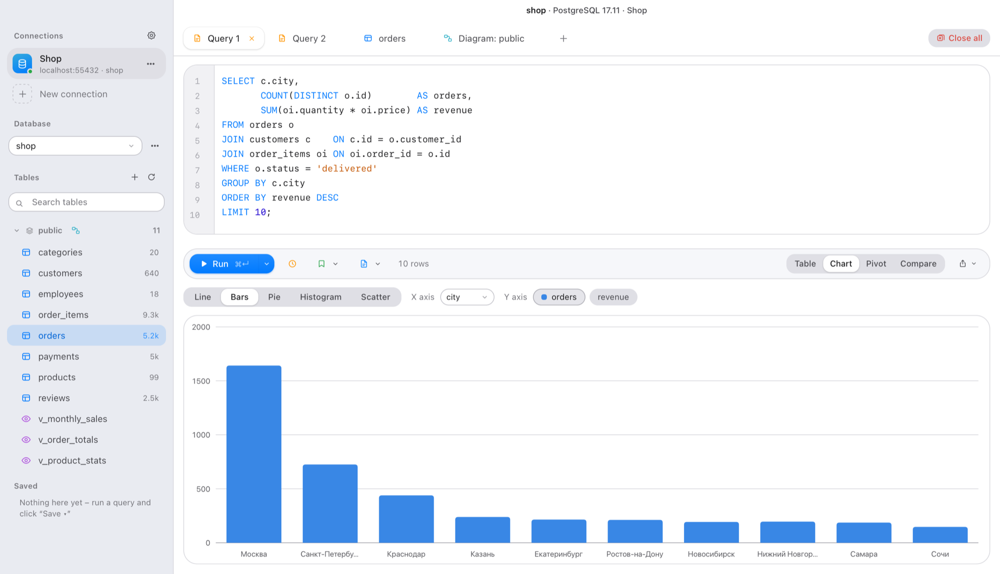

# Noir DB

[English](README.md) | **Русский**

**Клиент PostgreSQL для macOS с упором на SQL и анализ данных.**

В Noir DB есть умный SQL-редактор, безопасная правка таблиц в транзакциях и встроенные инструменты анализа: графики, сводные таблицы и сравнение результатов. Интерфейс в стиле Apple, с тёмной и светлой темой. Приложение написано на Python, pywebview и чистом HTML/CSS/JS, без фреймворков.

Интерфейс есть на русском и английском («Настройки → Оформление → Язык»).



## Скачать и запустить

Что нужно: Mac с чипом Apple (M1 или новее) и сервер PostgreSQL (на своём компьютере или удалённый).

1. На странице [Releases](../../releases) скачай `NoirDB-*.zip` и распакуй его.
2. Перетащи **Noir DB.app** в «Программы».
3. Приложение не заверено Apple, поэтому при первом запуске macOS его заблокирует. **Правый клик по приложению → «Открыть» → «Открыть».** Если всё равно не пускает: «Системные настройки → Конфиденциальность и безопасность → Всё равно открыть».
4. Добавь подключение к своему серверу PostgreSQL. Пароли хранятся в Связке ключей macOS.

**Демо-базы.** В проекте есть две учебные базы с выдуманными данными: `demo/noir_shop.sql` (интернет-магазин) и `demo/noir_university.sql` (университет: факультеты, студенты, оценки, оплата). Чтобы загрузить: **•••** рядом с выбором базы → «Новая база», затем «Импорт SQL» → выбери файл.

## Скриншоты

| График по результату запроса | Исправление ошибки в один клик |
|---|---|
|  |  |
| **Правка данных в таблице** | **Схема базы** |
|  |  |



*На скриншотах – демо-база из проекта с выдуманными данными, интерфейс на английском.*

## Возможности

### SQL-редактор
- Подсветка синтаксиса, номера строк, строка с ошибкой выделяется.
- **Выполнение запроса под курсором** (⌘↵) или всего текста (⇧⌘↵).
- **Автодополнение** таблиц, колонок (в том числе через псевдонимы вроде `o.`), ключевых слов и функций.
- **Подсказки JOIN по связям базы.** После `JOIN` первыми идут связанные таблицы – сразу с псевдонимом и условием `ON`.
- **Подсказки значений.** После `status = '` или `IN ('` редактор предлагает реальные значения из колонки.
- **Сниппеты** для частых аналитических запросов: топ-N, итоги по месяцам, доля от общего, накопительный итог, ранжирование, дубликаты, CTE. Колонки подбираются сами по данным.
- **Помощник по ошибкам.** Ошибка подчёркивается и объясняется простыми словами, а исправленный запрос подставляется в один клик. Понимает опечатки в названиях, пропущенные колонки в `GROUP BY`, неоднозначные колонки, необъявленные псевдонимы и многое другое. Частые проблемы видны ещё до запуска – прямо пока пишешь.
- **Переменные** `{{имя}}`. Над результатом появляются поля, значения передаются безопасно, параметрами.
- Форматирование SQL (⇧⌘F), поиск и замена (⌘F), комментирование строк (⌘/).
- **Транзакции.** В режиме «Авто» каждый запрос сразу сохраняется. В режиме «Вручную» изменения ждут «Сохранить (COMMIT)» или «Откатить».
- История запросов, сохранённые запросы, файлы `.sql`, вкладки восстанавливаются после перезапуска.

### Данные
- Просмотр таблиц: сортировка, поиск по всем колонкам, фильтры по колонкам, постраничный вывод.
- **Правка прямо в таблице**, как в Excel. Изменённые, новые и удалённые строки подсвечиваются и сохраняются вместе **одной транзакцией**: сохранится либо всё, либо ничего.
- При правке колонки-ссылки появляется список строк связанной таблицы с поиском.
- Значения-ссылки кликабельны и открывают связанную строку. «Где используется» показывает, какие строки ссылаются на текущую.
- **Статистика колонки**: количество, пустые, уникальные, минимум, максимум, среднее, медиана, частые значения и гистограмма.
- При выделении ячеек видны сумма, среднее, минимум, максимум и количество. Скопированное аккуратно вставляется в Excel, Numbers, Заметки, Word и мессенджеры.
- **Поиск значения по всей базе.**
- Импорт из CSV и Excel (`.xlsx`) – в существующую таблицу или в новую, типы колонок определяются сами.

### Аналитика
- **Графики**: линия, столбцы, круговая, гистограмма, точки.
- **Сводные таблицы** – считает сам PostgreSQL по всему результату.
- **Сравнение результатов.** Закрепи результат как «было», измени запрос и увидишь, какие строки добавились, удалились или изменились.
- Выгрузка в CSV и Excel (график – на отдельном листе) и графика в PNG.
- Результат можно сохранить как запрос, который обновляется при открытии, как таблицу-снимок в базе или как **представление** (VIEW).

### Структура
- Конструктор таблиц: создание и изменение таблиц – типы, ключи, обязательные и уникальные поля, значения по умолчанию, описания. Все изменения – одной транзакцией, SQL можно посмотреть заранее.
- Просмотр структуры: колонки, связи, индексы и DDL.
- **Схема базы** – таблицы и связи между ними картинкой.
- Создание, импорт и удаление баз.

### Безопасность
- **Подключения «только чтение»** – запрет действует на уровне самого PostgreSQL.
- Предупреждение об `UPDATE` и `DELETE` без `WHERE`, подтверждение опасных команд.
- Лимит времени запроса и остановка долгого запроса.
- Цветные метки подключений – например, красная для рабочей базы.
- **SSH-туннели** со входом по ключу или паролю.
- Переподключение после сна Mac.
- Понятные сообщения вместо технических ошибок PostgreSQL.

### Интерфейс
- Вид как у приложений macOS: тёмная, светлая или системная тема и режим *Liquid Glass* по желанию.
- Ширина колонок меняется и подбирается сама, выравнивание текста – для каждой колонки.
- Всё работает и в маленьком окне, от 900×560.

## Горячие клавиши

| Клавиши | Действие |
|---|---|
| ⌘ ↵ | Выполнить запрос под курсором (или выделенный кусок) |
| ⇧ ⌘ ↵ | Выполнить весь текст |
| ⌘ S | Сохранить изменения в таблице или запрос |
| ⌘ T | Новый запрос |
| ⇧ ⌘ F | Отформатировать SQL |
| ⌘ F | Найти и заменить |
| ⌘ / | Закомментировать строки |
| ⌘ C | Скопировать выделенные ячейки |
| Ctrl Пробел | Показать подсказки |

## Сборка из исходников

Нужен Python 3.9 или новее. Правый клик по `Установить Noir DB.command` → «Открыть». Скрипт создаст виртуальное окружение, поставит зависимости, соберёт приложение через PyInstaller и положит его в «Программы».

Для разработки: `python3 dev/dev_server.py` открывает интерфейс в браузере с настоящей базой. Тесты: `python -m unittest discover -s tests`.

### Устройство проекта

```
app/
  main.py        окно приложения (pywebview) и связь с macOS
  server.py      локальный HTTP API на 127.0.0.1 с защитой токеном
  api.py         методы, которые вызывает интерфейс, и понятные ошибки
  db.py          вся работа с PostgreSQL (psycopg 3)
  store.py       подключения, настройки, история (пароли – в Связке ключей)
  exporters.py   выгрузка в CSV и Excel
  tablefile.py   импорт CSV и Excel, определение типов
  sshtunnel.py   SSH-туннели через системный ssh
  ui/            интерфейс: чистый JavaScript, HTML и CSS
demo/            демо-базы
dev/             сервер для разработки, генераторы демо-данных и иконки
tests/           автотесты
```

Настройки и подключения хранятся в `~/Library/Application Support/NoirDB/`, пароли – в Связке ключей macOS.

## Лицензия

MIT, см. [LICENSE](LICENSE). Разработчик – Ян Колбунов, © 2026.
